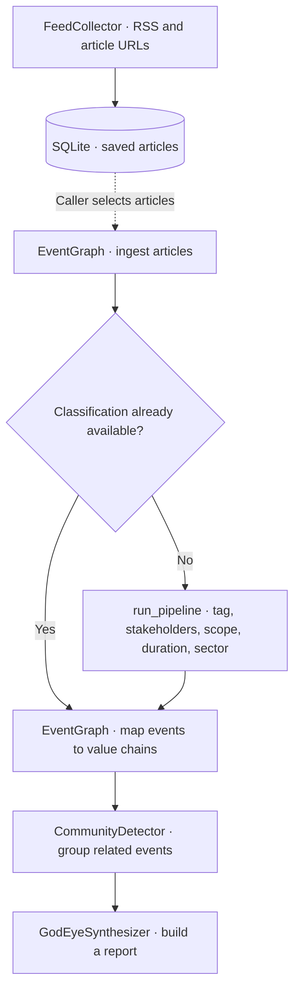

# News Analysis

**Turn news into a map of what changed, who is affected, and where the effects could show up next.**

News Analysis is a Python research project for exploring how economic events travel through supply chains and sectors. It collects articles from RSS feeds and direct URLs, extracts structured events, and maps them onto a graph of value chains. You can start with one report about a crop disruption and look for related events at downstream stages such as milling or distribution.

## 🔍 What it does

| Stage | What you get |
| --- | --- |
| Collection | Article text and metadata from RSS feeds and URLs, with SQLite storage |
| Classification | Event tags, affected stakeholder roles, estimated scope and duration, and sector mapping |
| Event analysis | A NetworkX graph for exploring downstream paths and grouping related events |
| Reporting | A “God’s Eye” report with cluster summaries and hypotheses to investigate |
| Fact retrieval | A separate Neo4j workflow for storing and querying facts extracted from articles |

## 🧰 Technology stack

| Technology | How News Analysis uses it |
| --- | --- |
| **Scrapling** | Fetch web pages asynchronously, with a headless-browser fallback for pages that need it |
| **Feedparser + Trafilatura** | Parse RSS feeds and extract article text from HTML |
| **llama.cpp via `llama-cpp-python` + GGUF** | Run event classification and embeddings with local models |
| **Qwen3 Embedding + GICS** | Match event descriptions to value-chain checkpoints and map them to industry categories |
| **NetworkX** | Traverse value chains and group related events into communities |
| **SQLite + SQLAlchemy** | Store and retrieve articles and their review state |
| **Neo4j + Cypher** | Store and query facts extracted from articles in a separate graph |

## How it fits together



The dashed arrow marks an explicit handoff. Collection, optional article review and cleaning, and graph analysis currently run as separate entry points. The report’s ripple paths follow the configured value-chain connections, and its opportunity hypotheses need independent verification.

## Sample output

Start with a report of storm damage to rice crops. The graph follows the configured path from cultivation to processing and surfaces a separate event about rising input costs at rice mills. An analyst can then check whether the two reports concern the same market and period.

Illustrative excerpt from `EventGraph.trace_ripple_effects()` using the demo events. Fields are omitted for readability.

```json
{
  "source_checkpoint": "rice_agriculture.cultivation",
  "related_events": [
    {
      "summary": "Rice milling companies face surge in paddy input prices and warehouse supply shortage",
      "direction": "increase",
      "matched_checkpoint": "rice_agriculture.processing"
    }
  ]
}
```

## 🚀 Set up and run

Use **Python 3.12**. From PowerShell:

```powershell
git clone https://github.com/Witnull/News-Analysis.git
cd News-Analysis
py -3.12 -m venv venv
.\venv\Scripts\python.exe -m pip install --upgrade pip
.\venv\Scripts\python.exe -m pip install -r requirements.txt
```

On macOS or Linux, create the environment with `python3.12 -m venv venv` and use `venv/bin/python` in the commands below. If pip needs to build `llama-cpp-python` from source, install a C/C++ toolchain or choose a compatible wheel. See the [llama-cpp-python installation guide](https://llama-cpp-python.readthedocs.io/en/latest/#installation).

### Run the graph demo

```powershell
.\venv\Scripts\python.exe -m src.modules.analysis.event_graph
.\venv\Scripts\python.exe -m src.modules.analysis.god_eye_reasoning
```

The demos use sample events and need no model weights, API keys, or Neo4j server.

### Collect and analyze your own articles

Place these local GGUF files in `models/` or update the model paths in the relevant modules.

| Default filename | Used for |
| --- | --- |
| `Ministral-3-3B-Instruct-2512-Q5_K_M.gguf` | Collection and filtering |
| `Ministral-3-8B-Instruct-2512-Q5_K_M.gguf` | Event classification and article cleaning |
| `Qwen3-Embedding-0.6B-Q8_0.gguf` | Value-chain and sector matching |

For Scrapling’s headless-browser fallback, activate the environment and run `scrapling install` to set up its browser dependencies. See the [Scrapling installation guide](https://scrapling.readthedocs.io/en/latest/#installation).

Run `python download_hf_model.py --help` inside the environment to see the model download options. Move the downloaded GGUF files to the configured paths before running inference.

Save this example as `run_news.py` in the repository root. Replace the example feed URL with one you want to follow, then run it with the environment’s Python.

```python
import asyncio

from src.core.types import Feed
from src.modules.analysis.event_graph import EventGraph
from src.modules.analysis.god_eye_reasoning import GodEyeSynthesizer
from src.modules.collector.collector import FeedCollector
from src.modules.store.store import ArticleStore


async def main():
    store = ArticleStore("sqlite:///articles.db")
    feed = Feed(
        url="https://example.org/feed.xml",
        publisher="Example publisher",
        category="Economy",
        type="rss",
        rss_type="custom",
    )
    collector = FeedCollector([feed], db=store, use_flaresolverr=False)
    await collector.run()
    graph = EventGraph()
    graph.ingest_articles(store.get_recent_articles(limit=20))
    report = GodEyeSynthesizer(graph).generate_god_eye_report()
    print(report["l2_god_eye_summary"])


if __name__ == "__main__":
    asyncio.run(main())
```

The first `ArticleStore` call creates the SQLite tables. The Alembic files are for migrating existing databases from the older schema. For the optional Neo4j fact graph, run Neo4j locally and set `NEO4J_PASSWORD` before opening the store.

## Project layout

| Path | Purpose |
| --- | --- |
| [`src/modules/collector/`](src/modules/collector/) | Fetching, extraction, filtering, and cleaning |
| [`src/modules/classifier/`](src/modules/classifier/) | Event tagging, stakeholder impact, duration, scope, and sector mapping |
| [`src/modules/analysis/`](src/modules/analysis/) | Event graph, ripple tracing, community detection, and reporting |
| [`src/modules/store/`](src/modules/store/) | SQLite article storage and Neo4j fact storage |
| [`src/modules/llm/`](src/modules/llm/) | Model loading, inference, API routing, and embeddings |
